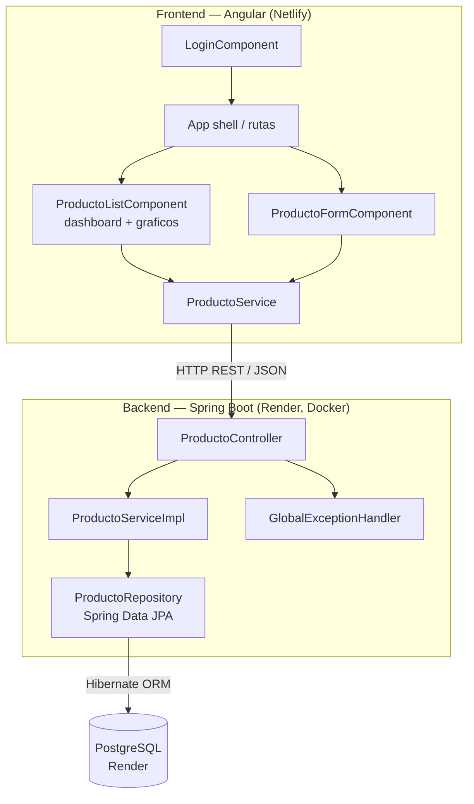

<div align="center">

# Producto API — CRUD Full Stack con Spring Boot + Angular


> API REST con Spring Boot + JPA/Hibernate sobre PostgreSQL, y un frontend Angular
> standalone/signals con dashboard, gráficos y diseño propio, desplegados en
> Render y Netlify respectivamente.

## Descripción

</div>

---

Implementación de una **API REST** en **Spring Boot 3 + Spring Data JPA (Hibernate)**
con operaciones CRUD completas sobre **PostgreSQL**, más un **frontend en Angular**
(standalone components, signals, Angular Material) que consume esa API con un
dashboard de estadísticas, gráficos y autenticación de demostración. Ambas partes
están desplegadas y funcionando en producción.

## Demo en vivo

| | URL |
|---|---|
| 🖥️ **Frontend** (Netlify) | [producto-api.netlify.app](https://producto-api.netlify.app) |
| ⚙️ **Backend** (Render) | [producto-api-tc60.onrender.com/api/productos](https://producto-api-tc60.onrender.com/api/productos) |

Usuario de demostración: **`admin`** / contraseña **`admin`**.

Una vez dentro, el propio frontend documenta el proyecto: el botón **Actividad**
muestra el enunciado de la actividad académica, y **Pasos** muestra cómo este
desarrollo cubre cada criterio de su rúbrica.

> El backend está en el plan free de Render — si lleva más de 15 min sin
> tráfico, el primer request tarda 30-50s en despertar. No es un error.

## Endpoints implementados

| Método | Endpoint | Descripción |
|---|---|---|
| GET | `/api/productos` | Listar todos los productos |
| GET | `/api/productos/{id}` | Obtener un producto por id |
| POST | `/api/productos` | Crear un nuevo producto |
| PUT | `/api/productos/{id}` | Actualizar un producto existente |
| DELETE | `/api/productos/{id}` | Eliminar un producto |

## Modelo de datos: Producto

| Campo | Tipo | Descripción |
|---|---|---|
| `id` | Long | Identificador único (autogenerado) |
| `nombre` | String | Nombre del producto |
| `descripcion` | String | Descripción breve |
| `precio` | BigDecimal | Precio del producto |

## Arquitectura



Separación en capas (`controller` / `service` / `repository` / `model` / `dto` /
`exception` en el backend; `core` / `features` / `shared` en el frontend) que
facilita el mantenimiento, la escalabilidad y las pruebas del proyecto.

## Manejo de errores

Todos los errores devuelven un cuerpo JSON consistente:
```json
{
  "timestamp": "2026-07-29 10:00:00",
  "status": 404,
  "error": "Recurso no encontrado",
  "message": "No se encontro el producto con id: 99",
  "path": "/api/productos/99"
}
```
- `404` — producto no encontrado, o ruta inexistente.
- `400` — datos inválidos (validaciones `@NotBlank`, `@NotNull`, `@DecimalMin`) o tipo de parámetro incorrecto.
- `500` — error interno no controlado (mensaje sanitizado, sin exponer detalles internos).

## Pruebas

- **Backend**: JUnit 5 + MockMvc, cubriendo los 4 métodos CRUD y los casos de error.
- **Frontend**: Vitest, cubriendo servicios, componentes y flujos de usuario.
- **Manuales**: colección de Postman incluida (`postman_collection.json`) con los
  4 métodos y casos de error listos para importar.

## Cómo ejecutar el proyecto localmente

### Backend

**Requisitos:** Java 17+, Maven 3.9+, PostgreSQL local (o una base gratuita en Supabase/Render).

```bash
# Crear la base (si es local)
createdb producto_db

# Configurar credenciales
export DB_URL=jdbc:postgresql://localhost:5432/producto_db
export DB_USERNAME=postgres
export DB_PASSWORD=tu_password

# Ejecutar
mvn spring-boot:run
```

La API queda en `http://localhost:8080/api/productos`. Hibernate
(`spring.jpa.hibernate.ddl-auto=update`) crea la tabla `productos`
automáticamente — no hace falta SQL manual.

### Frontend

```bash
cd frontend
npm install
npx ng serve
```

Abre `http://localhost:4200` — por defecto apunta al backend local
(`http://localhost:8080/api`).

## Despliegue

El proyecto está configurado para desplegarse automáticamente en cada push:

- **Backend → Render**: `render.yaml` define un servicio Docker (`Dockerfile`
  con build multi-stage Maven + JRE 17). Variables de entorno (`DB_URL`,
  `DB_USERNAME`, `DB_PASSWORD`, `ALLOWED_ORIGIN`) se configuran manualmente en
  el dashboard de Render (`sync: false`, nunca versionadas).
- **Frontend → Netlify**: `frontend/netlify.toml` define el build
  (`npm run build -- --configuration=production`) y el directorio de
  publicación (`dist/frontend/browser`). `frontend/public/_redirects` habilita
  el ruteo del SPA.

## Contexto académico

**Asignatura:** Arquitectura de Aplicaciones Web · **Unidad:** 2 — Backend con
servicios RESTful CRUD sobre base de datos usando un framework
**Institución:** Politécnico (Maestría en Arquitectura de Software)
**Autor:** Alejandro Mendoza — Ingeniero de Software

---

## Autor

**Alejandro Mendoza**
Ingeniero de Software

[](https://github.com/AlejoTechEngineer)
